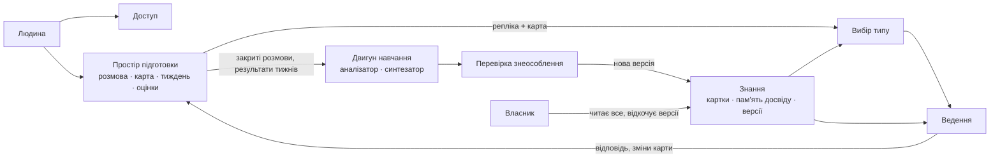

# Domain map — «Бігова група», M1

## Бачення (з розділу «Ядро»)
Застосунок веде людину до її власного тижня тренувань і вчиться з того, як тижні пройшли. Коли підходящого типу тижня
немає, він чесно це каже, і такий випадок стає кандидатом на новий тип (G3, G7).

## Механізми ядра
- **Знання** — картки типів тижня: коли тип підходить і коли ні, за якими ознаками в розмові це видно, фази розмови.
  Поруч — пам'ять досвіду з версіями (G3, G7).
- **Вибір типу** — профіль ситуації людини → два-три типи з поясненням або відповідь «підходящого типу немає» →
  людина обирає (G1, G7).
- **Ведення** — веде по фазах обраного типу, одне питання за раз, оновлює карту підготовки, повертає вибір типу, коли
  людина застрягла (G1, G2, G5).
- **Двигун навчання** — аналізатор: закрита розмова плюс те, як пройшов тиждень, → спостереження з посиланням на
  місце. Синтезатор раз на тиждень зводить спостереження всіх людей у висновки. Застосування записує нову версію
  знань (G3, G6).
- **Перевірка знеособлення** — перш ніж нова версія знань стане чинною, один виклик моделі перевіряє, що в ній немає
  подробиць конкретних людей. Сценарій: інакше історія одного друга з'явиться в розмові іншого, і відкат цього не
  скасує (G4). Ціна: один виклик моделі на версію, кілька на тиждень.

## Допоміжне
- **Доступ** — вхід через Google-акаунт, і хто є хто (G4, N2).

## Елементи
| Елемент | Що робить | Джерело |
|---|---|---|
| Знання | картки типів тижня, пам'ять досвіду з версіями | G3, G7 |
| Вибір типу | профіль ситуації → типи або «підходящого немає» | G1, G7 |
| Ведення | веде по фазах, оновлює карту підготовки | G1, G2, G5 |
| Двигун навчання | спостереження → висновки → нова версія знань | G3, G6 |
| Перевірка знеособлення | нова версія знань без подробиць людей | G4 |
| Простір підготовки | розмова, карта, тиждень, оцінки | G2, D1 |
| Доступ | вхід, хто є хто | G4, N2 |

## Пропозиції
- Фільтр травм із дослідження — не будуємо: N3 — межа, жодна ціль його не вимагає. Ціна — перевірка кожного
  повідомлення.
- Bandits для вибору типу — не будуємо: потрібні сотні розмов, а їх у нас не буде.
- Лист-нагадування — не будуємо: D1 збирає оцінки, коли людина повертається.

## Звірка з цілями
- служить: G1, G2, G3, G4, G5, G6, G7, D1
- вибір між варіантами розв'язав: P1, P3 (власник бачить усі журнали в першій версії)
- не-цілі й обмеження: N3 — нічого не будуємо; N1 — готових тижнів без розмови немає; C1 — Cloud Run у Європі.
