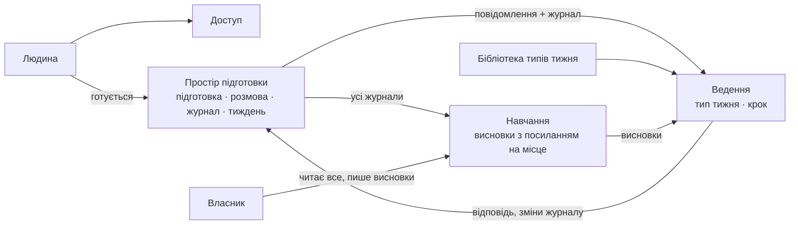

# Domain map — «Бігова група», M1, редакція 2

Після правок власника: «Безпеку прибрати, листів не треба, власник читає все».

- «Безпеку» прибрано: N3 — межа продукту, під неї нічого не будуємо.
- Листів немає: питання про тиждень людина бачить, коли повертається.
- **Навчання.** Власник читає всі журнали і пише висновки з посиланням на місце в розмові. Висновки повертаються у
  Ведення.

## Звірка з цілями
- служить: G1, G2, G3, G4, G6
- вибір між варіантами розв'язав: P3
- не-цілі й обмеження: N3 — нічого не будуємо; C1 — Cloud Run у Європі.
