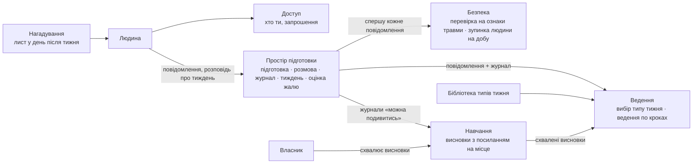

# Domain map — «Бігова група», M1, чернетка 1

Сім частин, у кожної своя мова і свій ритм життя.

- **Простір підготовки** — підготовка живе тижнями. Тут журнал, тиждень і оцінка жалю (D1).
- **Безпека** — запобіжник перед усім іншим (N3). Кожне повідомлення людини спершу перевіряється на ознаки травми;
  при підозрі тренування людини зупиняються на добу, і вона отримує номер спортивного лікаря.
- **Ведення** веде людину до її тижня і не дає готового плану (N1).
- **Бібліотека** — типи тижня.
- **Навчання** робить висновки з посиланням на місце в розмові (G6); власник їх схвалює (G3).
- **Нагадування** — лист у день після тижня, щоб оцінки жалю справді були (D1).
- **Доступ** — вхід, і хто є хто (G4).

## Звірка з цілями
- служить: G1, G2, G3, G4, G6, D1
- вибір між варіантами розв'язав: P3
- не-цілі й обмеження: N3 — забезпечено частиною «Безпека»; C1 — Cloud Run у Європі.
